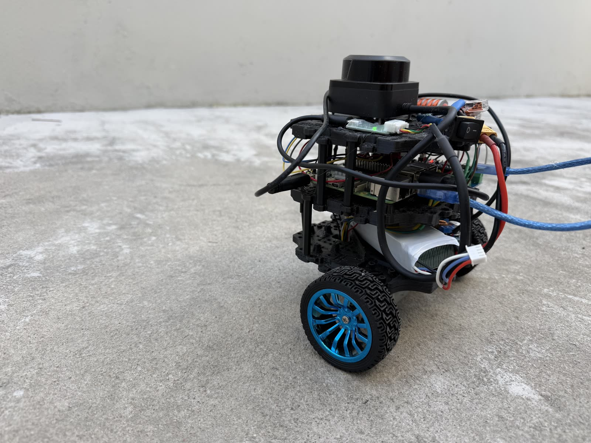
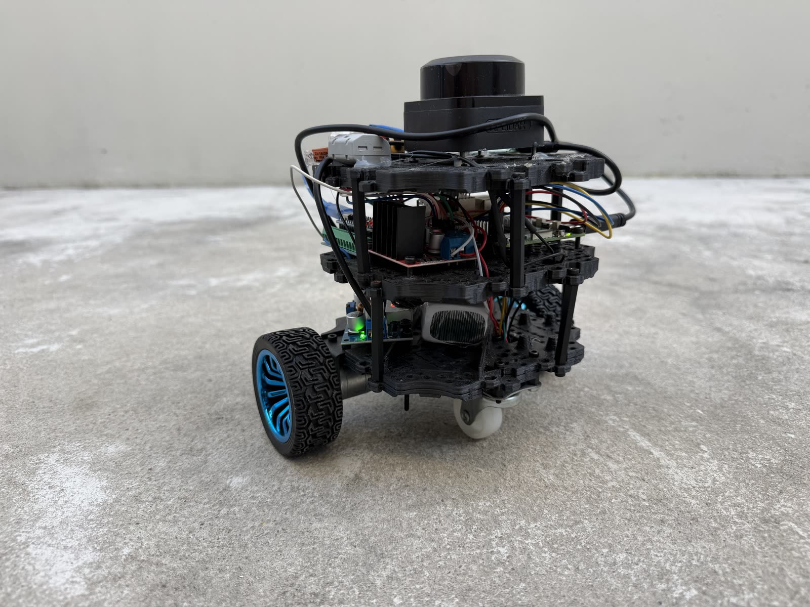
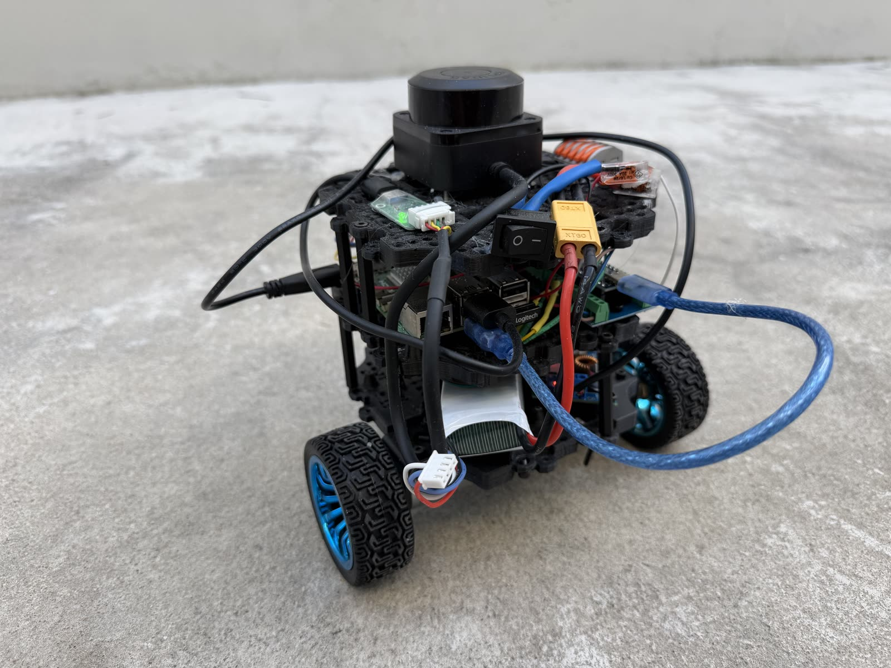
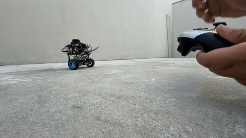
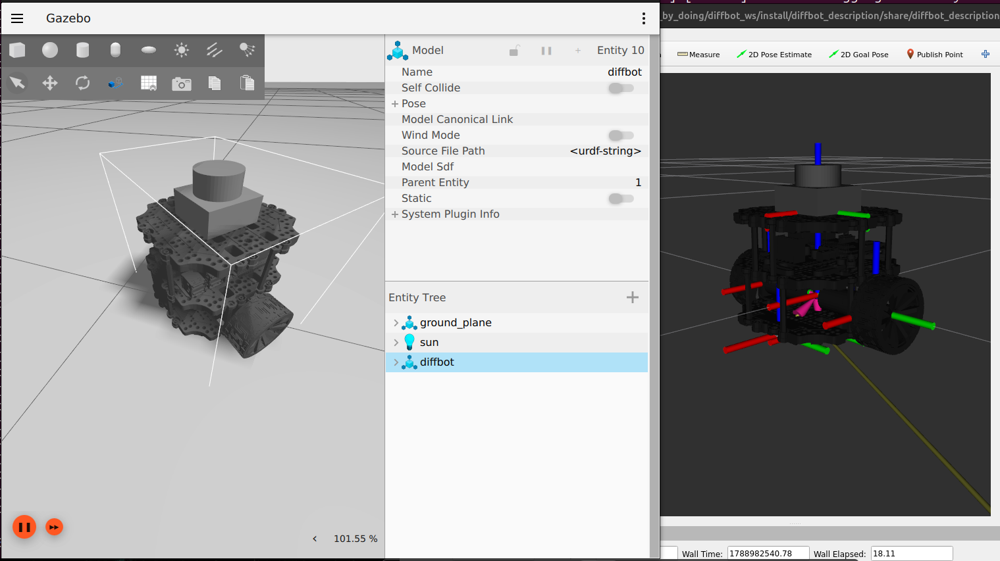

# DiffBot

An autonomous differential-drive robot built from scratch in ROS 2 — control, odometry, localization, SLAM, path planning, and navigation.

Following the base structure of Antonio Brandi's "Self-Driving and ROS 2 - Learn by Doing" reimplemented

## The Robot

<p align="center">
  
  
  
</p>

<p align="center">
  
  <br>
  <sub>Joystick teleop — full clip: <a href="media/diffbot_teleop.MOV">diffbot_teleop.MOV</a></sub>
</p>

Sensors: MPU6050 IMU and an [RPLIDAR C1](datasheets/rplidar_c1_datasheet.pdf) 2D LiDAR.

## Roadmap

- **Phase 1 — Control & Odometry**: ROS2 basics, locomotion, control, kinematics, TF2, odometry, sensor fusion (EKF). 
- **Phase 2 — Localization & Mapping**: probability, global localization, sensors, maps, SLAM. 
- **Phase 3 — Planning & Navigation**: path/motion planning, obstacle avoidance, Nav2, decision making. 

## Structure

```
diffbot_ws/         # real ROS2 workspace (colcon) — code lives and builds here
```

## Packages

| Package | Language | Purpose |
| --- | --- | --- |
| `diffbot_description` | URDF/Xacro | 3D robot model, visual/collision geometry, joint definitions, and simulation parameters |
| `diffbot_msgs` | Interfaces | Custom msg/srv/action definitions used across DiffBot packages |
| `diffbot_controller` | Config/Launch/C++ | ros2_control controllers, the `simple_controller` differential-kinematics node, and joystick teleop |
| `diffbot_localization` | Config/Launch/C++ | Sensor fusion — `imu_republisher` re-frames `/imu/out` to `base_footprint_ekf`; `robot_localization` EKF (`ekf.yaml`) fuses it with noisy wheel odometry (`odom_noisy`). Also `global_localization.launch.py` — `nav2_map_server` + `nav2_amcl` (`amcl.yaml`) + `nav2_lifecycle_manager`, particle-filter localization against a static map from `diffbot_mapping`; part of `simulated_robot.launch.py` bringup by default (`use_slam:=false`) |
| `diffbot_mapping` | C++/Data | `mapping_with_known_poses` — hand-built log-odds occupancy grid mapper (Bresenham + inverse sensor model) from `/scan` + TF, run manually; pre-built maps (`small_house`, `small_warehouse`) for `nav2_map_server`; `slam.launch.py` — `slam_toolbox` (graph SLAM) + `map_saver_server`, wired into bringup via `use_slam:=true` |
| `diffbot_firmware` | C++/Python/Arduino | Real hardware only — `diffbot_interface` (`hardware_interface::SystemInterface` plugin, talks to the Arduino over `LibSerial`/`/dev/ttyUSB0`), `mpu6050_driver.py` (I2C IMU driver publishing `/imu/out`), and the `robot_control`/`robot_control_inverted` Arduino sketches |
| `diffbot_utils` | C++ | `safety_stop` — watches `/scan`, publishes the `twist_mux` `safety_stop` lock and calls its `joy_turbo_increase`/`decrease` actions as obstacles enter the warning/danger zones |
| `diffbot_bringup` | Launch | Top-level launch files — `simulated_robot.launch.py` (Gazebo + controller + joystick + EKF localization + `safety_stop`) and `real_robot.launch.py` (`diffbot_firmware` hardware interface + controller + joystick + `mpu6050_driver` + `safety_stop`) |

## Bringup

Top-level launch files (`diffbot_bringup`) that bring up the whole robot in one command:

```sh
ros2 launch diffbot_bringup simulated_robot.launch.py   # gazebo + controller + joystick + EKF localization
ros2 launch diffbot_bringup real_robot.launch.py        # diffbot_firmware + controller + joystick + mpu6050_driver
```

Both always run the full `diff_drive_controller` path; `real_robot.launch.py` has no EKF step yet.

`simulated_robot.launch.py` also takes `use_slam` (default `false`): `false` runs AMCL against a known map (`map_name`, default `small_house`); `true` runs `slam_toolbox` instead to build a new map live, with a matching RViz config for each. The EKF (`local_localization`) runs either way — it's a separate, lower layer (fuses wheel odom + IMU) from this map-relative choice.

```sh
ros2 launch diffbot_bringup simulated_robot.launch.py world_name:=small_house use_slam:=true
```

<p align="center">
  
  <br>
  <sub>simulated_robot.launch.py — Gazebo (left) and RViz (right)</sub>
</p>

## ros2_control

Wheel velocity control goes through `ros2_control`, configured in `diffbot_controller/config/diffbot_controllers.yaml` and picked at launch via `use_simple_controller`:

- **`simple_controller`** (default) — hand-built path: `simple_controller.cpp` converts `cmd_vel` to wheel velocities via differential-drive inverse kinematics, no odometry.
- **`diffbot_controller`** (`use_simple_controller:=False`) — built-in `diff_drive_controller`, also publishes `/odom` + TF and enforces velocity/acceleration limits.

```sh
ros2 launch diffbot_controller controller.launch.py                              # simple_controller (default)
ros2 launch diffbot_controller controller.launch.py use_simple_controller:=False  # diff_drive_controller
```

## Comparing odometry (PlotJuggler)

With Gazebo, `controller.launch.py` and `local_localization.launch.py` all running, install and open PlotJuggler:

```sh
sudo apt install -y ros-humble-plotjuggler-ros
ros2 run plotjuggler plotjuggler
```

Streaming → Start: "ROS2 Topic Subscriber", pick `/diffbot_controller/odom` (truth), `/diffbot_controller/odom_noisy` (noisy), and `/odometry/filtered` (EKF output). Plot `pose/pose/position/x` vs `.../y` from each on the same XY plot to compare trajectories visually.


## Build

This repo uses [Git LFS](https://git-lfs.com/) for large binary assets (robot
photos/videos in `media/`, Gazebo world models in
`diffbot_description/models/`). Install it **before** cloning, or those files
come through as tiny text pointers instead of their real content:

```sh
git lfs install              # once per machine
git clone <repo-url>
cd diffbot_ws
# already cloned without LFS set up? pull the real files now:
git lfs pull
```

```sh
colcon build
. install/setup.bash
```

## Battery (3S LiPo, 2.2Ah)

| | Voltage | Per cell |
| --- | --- | --- |
| Fully charged (safe) | 12.6V | 4.2V |
| Minimum charged (safe) — below this can cause permanent damage | 9V | 3.0V |
| Recommended cutoff range | 9.9V – 11.1V | 3.3V – 3.7V |
| Storage voltage | 11.4V | 3.8V |

Safe charging current: 1C × 2.2Ah = **2.2A**

## Real hardware setup (Raspberry Pi 5)

The onboard computer is a Raspberry Pi 5 (16GB), running Ubuntu Server 24.04 + a ROS 2 Humble
Docker container. OS install, networking, Bluetooth joystick pairing, udev rules, PlatformIO
(Arduino Nano firmware), and the Docker setup are documented in
[`docs/raspberry_pi_setup.md`](docs/raspberry_pi_setup.md).

## Notes

- **Gazebo inside Docker**: if `ros2 launch diffbot_description gazebo.launch.py` starts but the spawn node (`ros_gz_sim create`) loops forever on `Requesting list of world names` and the Gazebo GUI stays black/frozen, Ignition Transport is likely picking the wrong network interface for discovery (common on hosts with multiple NICs/Docker bridges). Fix by pinning discovery to loopback before launching:

  ```sh
  export GZ_IP=127.0.0.1
  export IGN_IP=127.0.0.1
  ros2 launch diffbot_description gazebo.launch.py
  ```

- **Simulated worlds other than empty** (`small_house`, `small_warehouse` — used for mapping/localization testing): world files live in `diffbot_description/worlds/`; the ~95MB of AWS RoboMaker furniture/wall models they reference live in `diffbot_description/models/`, tracked via Git LFS (see "Build" above — make sure `git lfs pull` has actually run). Then:

  ```sh
  ros2 launch diffbot_bringup simulated_robot.launch.py world_name:=small_house
  ```

- **Dependencies**: declared per-package in each `package.xml`. Install them all with:

  ```sh
  rosdep update
  rosdep install --from-paths src --ignore-src -r -y
  ```

## Acknowledgments

DiffBot is a from-scratch reimplementation of the robot built in Antonio Brandi's "Self-Driving and ROS 2 - Learn by Doing" course series — every package here was written independently, following the course's structure and design as a reference, not copied from it. The original course repos are licensed under the Apache License 2.0:

- [Self-Driving and ROS 2 - Learn by Doing! Odometry & Control](https://github.com/AntoBrandi/Self-Driving-and-ROS-2-Learn-by-Doing-Odometry-Control)
- [Self-Driving and ROS 2 - Learn by Doing! Map & Localization](https://github.com/AntoBrandi/Self-Driving-and-ROS-2-Learn-by-Doing-Map-Localization)
- [Self-Driving and ROS 2 - Learn by Doing! Plan & Navigation](https://github.com/AntoBrandi/Self-Driving-and-ROS-2-Learn-by-Doing-Plan-Navigation)

## License

Licensed under the [Apache License 2.0](LICENSE), matching the license of the course material this project is based on.
